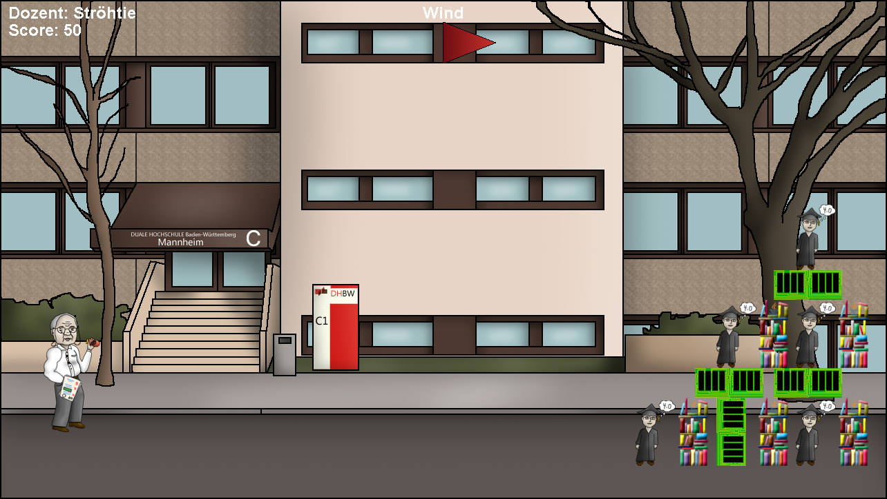

# 

**_by_** ☕ **_Coffee Productions (TINF13AIBC/MF)_**

## Contributors

- Tim Adamek
- Andreas Geis
- Laura Hillenbrand
- Stefanie Raschke
- Tobias Raschke
- Nick Steyer

## Gameplay



You play a professor throwing things at students to get them "exmatrikuliert" (expelled). Each
level hides a number of students behind barricades of RAM stacks and library book piles. Clear a
level by hitting every student before you run out of score.

Before each throw, use `↑`/`↓` to pick which professor throws next. Each professor has one
signature projectile, and each projectile can only destroy one kind of target:

| Professor | Throws | Destroys |
|---|---|---|
| Ströhtie | Exam papers | Students (1 hit kills, worth 100 pts) |
| Speedy | A little Android robot | Library book stacks (3 hits to clear, 10 pts/hit) |
| Muse | A pointer | RAM stacks (3 hits to clear, 10 pts/hit) |

Hitting the wrong target type does nothing. So the puzzle is: smash a path through the
barricades with Speedy/Muse, then switch to Ströhtie to finish off the exposed students.

Each level starts with a fixed score budget. Every throw costs 10 points, whether it hits
anything or not; destroying a barrier segment earns 10 points per effective hit (throwing
harder can land 2-3 hits at once, based on impact velocity); killing a student earns 100
points. If your score drops to 0 or below, you lose the level — clear all students before that
happens to win and unlock the next one. Random wind (shown by the flag at the top) pushes your
throw sideways, so factor it into your aim.

### Controls

Everything is keyboard-driven — there is no mouse support.

- **Menus:** `←`/`→` to move between options, `Enter` to select.
- **Aiming:** `←`/`→` set the throw angle, `↑`/`↓` switch the active professor.
- **Power:** press `Space` to lock the angle; a power bar bounces back and forth automatically —
  press `Space` again to lock in the throw's force.
- **Throw:** the arm swings and releases the projectile automatically; gravity and wind take
  over from there.
- `Esc` pauses the game; `Space` advances to the next level (or retries) after winning/losing.

## Building and Running

The game is plain Java built on [Slick2D](http://slick.ninjacave.com/)/LWJGL2. There is no
Maven/Gradle file, so `setup.sh` fetches the required jars (Slick2D, LWJGL 2.9.3, JAXB) from
Maven Central and compiles the sources; `run.sh` then launches the game:

```sh
./setup.sh   # downloads dependencies into libs/ and compiles into out/
./run.sh     # starts the game
```

Both scripts expect an x86_64 JDK 11 (e.g. Temurin 11) at
`/Library/Java/JavaVirtualMachines/temurin-11.jdk`. This is required even on Apple Silicon
Macs, since LWJGL2's native libraries only exist for x86_64/i386 — the x86_64 JDK runs
transparently under Rosetta 2. On Intel Macs, Linux, or Windows a matching native JDK works
the same way; just adjust the `JAVA`/`JAVAC` path at the top of each script. Java 11 is used
(rather than 8) because it's more readily available for x86_64 on modern machines; the scripts
pull in JAXB (`javax.xml.bind`) separately since it was removed from the JDK in Java 11.

---

_The Android robot is reproduced or modified from work created and shared by Google and used according to terms described in the Creative Commons 3.0 Attribution License._